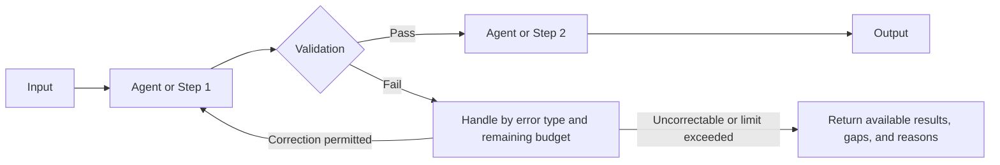

# Agent System Design Document: {System Name}

> Use this full template after confirming that a model is needed. When ordinary code suffices, deliver a short conclusion under the main process without this template. When using this template, retain all sections and provide content in each; explain why any section is not applicable. For sections or table rows exempted by the main process's tailoring table, one sentence at the section start, "Not applicable under the selected [tier] scope," suffices without filling every row. Consolidate items to be confirmed and temporary assumptions in Section 11; neither authorizes execution nor represents empirical testing.

## 0. Summary

- Problem to solve:
- Architecture tier: Prompt / Workflow / Single Agent / Multi-Agent
- Selected design patterns (as needed; write None when absent):
- Overall self-review score: X.X / 5.0 (Reviewer: author self-review / independent review), N serious issues; design self-review scores assess the document only. Judge actual effectiveness and release permission separately

## 1. Requirements

| Item | Content |
|---|---|
| Inputs (sources, formats, scale, quality) | |
| Outputs (forms, consumers) | |
| Success criteria (measurable) | |
| Latency constraints | |
| Cost constraints (per run, monthly) | |
| Compliance and data security | |
| Error consequences (acceptable level) | |
| Current state (existing systems, data, tools, manual processes) | |

AI suitability conclusion (current baseline, actual value, information/authorization and risk prerequisites, total-cost hypotheses; no AI needed / defer / limited pilot / proceed with evidence, and items awaiting validation):

## 2. Architecture Selection

- Selected tier (also state control mode and task-role or Agent counts):
- Selection rationale:
- Why not a simpler tier:
- Performance-constraint checks (acceptable latency and cost):
- Main risks:

## 3. Overall Architecture

Architecture diagram (Mermaid or PlantUML recommended):

Orchestration patterns and combinations:

| Pattern | Where Used (Primary or Supporting) | Benefits and Costs |
|---|---|---|

Orchestration control boundaries (node dependencies and gates; applicable permitted routes, aggregation conditions, dynamic tasks, and concurrency limits; back-edge exits and cross-node total budgets):

## 4. Agent Definitions

Use one table per Agent. At the Workflow tier, define each LLM step instead in this section.

### 4.x {Agent Name}

| Item | Content |
|---|---|
| Role | |
| Goal | |
| Operating guidelines or Backstory (write Not applicable if unnecessary) | |
| Reasons for independent existence (actual context, tool, or permission isolation; insufficient simpler alternatives and costs; role, node, and instance counts) | |
| Responsibility owner, artifact acceptor, and dispute destination | |
| Inputs | |
| Output structure | |
| Completion criteria and checking mechanisms | |
| Stop conditions, attempt or time limits, and counting conventions | |
| Reasoning approaches and rationale (select as needed; no need to publish internal chains of thought) | |
| Model selection and rationale | |
| Prohibited actions | |

## 5. Tool Design

| Tool | User | Description (Function, Outputs, When to Use, Boundaries) | Parameters and Validation Constraints | Returns, Evidence, and Continued Read Access | Errors and Next Destinations | Read/Write Permissions | Risk Level | Authorization or Approval and Timeouts |
|---|---|---|---|---|---|---|---|---|

Integration or combination approach (local functions, MCP, Skills) and rationale; for external services, specify supported client versions, trusted authentication sources, and tool allowlists:

## 6. Context and Memory

| Item | Design |
|---|---|
| Effective context budget (counting scope, output reservations, soft triggers, hard limits) | |
| Startup loading (goals, trusted instructions, necessary state, navigation) | |
| On-demand sources and retrieval (scope, methods, evidence references, no-result and old-version handling) | |
| Pruning strategy (what to discard, rereading evidence, protecting message associations) | |
| Compaction strategy (triggers, required information, trust boundaries, failure destinations) | |
| Task notes and recovery (actual progress, unresolved items, artifacts, action states, remaining budgets) | |
| Long-term memory (whether needed, admission, sources, scopes, updates, conflicts, invalidation) | |
| Sub-Agent context isolation (state rationale, input, and return boundaries as needed) | |

## 7. Collaboration and Handoffs

For autonomous loops, specify each iteration's actions, actual feedback, completion, and stop conditions. Fixed workflows and combined patterns both define necessary data handoffs, even with one model or Agent. If handoffs, shared state, or sub-Agents are genuinely absent, write "Not applicable" with reasons in corresponding subsections.

### 7.1 Handoff Table

| Upstream | Downstream | Transferred Fields and Trusted Task Association | Required Earlier Artifacts and Versions | Format, Business, and Artifact Acceptance Rules | Failure Handling | Correction or Retry Limits |
|---|---|---|---|---|---|---|

### 7.2 Shared State and Communication

- Method and necessity (direct calls, shared state, messages, pub/sub, or shared workspaces; cross-system protocols as needed):
- Task/user scope, lifecycle, and versions of fields, keys, resources, or topics:
- Owners, readers, permitted write scope, and authoritative publication entry points:
- Concurrency, conflicts, and applicable acknowledgments and duplicate/late-result handling:
- For priorities, specify ready-task filtering, rules, tie-breaking/maximum waits, and budget reservations as needed; write Not applicable without resource competition:

### 7.3 Dispatch Contracts

For each sub-Agent, write self-contained inputs using the seven `dispatch` elements in `handoff-contract-template.json`, attaching them here or in an appendix. Necessary earlier artifacts must be readable downstream. Define concrete business return fields under `handoff`; the host actually executes `gate` rules. Specify trusted task/instance association, permitted delegation relationships, maximum depth, and cross-node shared budgets. Without nesting, add no layers or protocols.

## 8. Human Intervention

| Intervention Point and Owner | Triggers | Actual Material and Request/Version Binding | Permitted Decisions and Approver Qualifications | Validity, Timeout/Rejection, and Late-Reply Handling | Resume Node and Prechecks |
|---|---|---|---|---|---|

Human interaction entry points and unified trusted records (reuse controlled entry points; add Managers as needed. Separate read receipts from approval, approval from authorization; stopping/takeover independent of models):

## 9. Reliability, Cost, and Security

| Item | Design |
|---|---|
| Error classification, whether actions occurred, and permitted handling | |
| Initial/additional retries, corrections, and loop limits; wait and termination exits | |
| Necessary side-effect action identity, idempotency/deduplication expiry, unknown-outcome verification, and conflict handling | |
| Degradation scope, gaps, and authorization/acceptance conditions that must remain | |
| State saving and checkpoint recovery (versions, approvals, actions, execution ownership, remaining budgets) | |
| Stop, cancellation, late results, and applicable rollback/compensation; truthfully record irreversible actions as having occurred | |
| Shared task quotas, counting scope, pre-call reservations/post-call settlement, soft estimates/hard limits, exceeded-limit exits | |
| Model selection and necessary fallbacks (quality/privacy/compatibility checks; do not bypass rejection) | |
| Trusted identity, object/data authorization, minimal tool permissions, necessary execution isolation | |
| Required security/audit components failing closed, optional telemetry-failure handling | |
| Input protection and external-instruction trust boundaries (rules are one defense layer only) | |
| Output, recipients, sensitive-data, and credential boundaries | |
| Host-observable events, actual rejected-path verification, redacted references, audit retention | |

## 10. Evaluation and Iteration

| Item | Design |
|---|---|
| Hypotheses and baselines, suitability/prototype validation, unvalidated scope | |
| Case sources, versions, counts, and coverage; development/regression/holdout groups and data governance | |
| Tested boundaries, fixtures/initial state, identities/scopes, reset/isolation, retry/iteration and resource protocols | |
| Evaluation levels (outputs, actual terminal states, necessary processes, resources); evidence scope of Mock/integration/UAT | |
| Scoring methods, versions, positive/negative examples, model-judge calibration, invalid/missing-evidence handling | |
| Single-run/pass@k/pass^k selection, run counts, assumptions, uncertainty; do not cherry-pick best outcomes | |
| Planned/executed/validly scored counts, denominators, unexecuted/invalid/failed/rerun cases, coverage gaps | |
| Fixed baseline/candidate snapshots, slice/paired comparisons, baseline and case/criterion change rules | |
| Change triggers, required checks/thresholds, version-bound pending/blocking/review/acceptance; release/rollback permissions | |
| Production metric semantics, windows, sampling, latency/missing data, owners, response/recovery | |
| Signal verification, failure classification, five retrospective questions, root causes, and proposal/validation/approval/activation; autonomous learning as needed | |

Draft evaluation cases (at least 3, covering main flow, boundaries, and failures; drafts do not mean execution or system passing):

| ID/Version and Source | Inputs and Fixtures/Initial State | Required Criteria and Optional Reference Answers | Type/Risk | Execution, Scoring, and Evidence Plan | Draft/Actual State and Gaps |
|---|---|---|---|---|---|

## 11. Items to Confirm and Assumptions

| Item | Current Assumption | Affected Scope | Who Must Confirm |
|---|---|---|---|

## 12. Framework Implementation (Optional)

- Selected frameworks, SDKs, model clients, and versions; maintenance/deprecation status and rationale. State reasons if no framework is needed:
- Field, node, dependency, and validation-location/owner mapping for the same dispatch/handoff contract:
- Stop counting and shared call budgets, approval entry points, state/recovery, actual identity, and necessary permission mapping:
- Evidence scope of construction/interface test doubles/actual frameworks and services; compatibility and unimplemented gaps:

## 13. Self-Review Results

Use the report format in Section 8 of `design-self-review-checklist.md`, embedded directly in this section by default: dimension scores, hard checks, unmet/partially met checklist details, issue severity, anti-patterns, and improvement recommendations. For full audits requested by users, attach a separate self-review file listing every check item.
